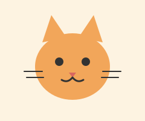

# 第 2 關：清單與連結 🔗

> 網頁之所以叫「網」，是因為頁面之間可以用連結串在一起。

## 這關會學到

- 兩種清單：`<ul>`（項目符號）、`<ol>`（數字編號）
- 連結 `<a>` 和圖片 ``
- 什麼是**屬性**（attribute）

## 觀念小抄

### 清單

```html
<ul>
  <li>蘋果</li>
  <li>香蕉</li>
</ul>
```

把 `ul` 換成 `ol`，前面的小圓點就會變成 1. 2. 3.。

### 屬性

有些標籤需要額外的資訊，寫在開頭標籤裡，格式是 `名字="值"`：

```html
<a href="https://www.google.com">去 Google</a>

```

- `href`：連結要去的網址
- `src`：圖片檔案的位置（同一個資料夾就直接寫檔名）
- `alt`：圖片的文字說明
- `` 是少數**沒有結尾標籤**的標籤

## 任務

打開 `start.html`，完成：

1. 一個 `<ul>` 清單（至少 3 項）
2. 一個 `<ol>` 清單（至少 3 個步驟）
3. 一個 `<a>` 連結
4. 一張 `` 圖片（可以用資料夾裡的 `cat.svg`），要有 `alt`

## 額外挑戰

- 在 `<a>` 裡加上 `target="_blank"`，連結會在新分頁打開。
- 試試把 `` 放進 `<a>` 裡面，讓圖片可以點。
